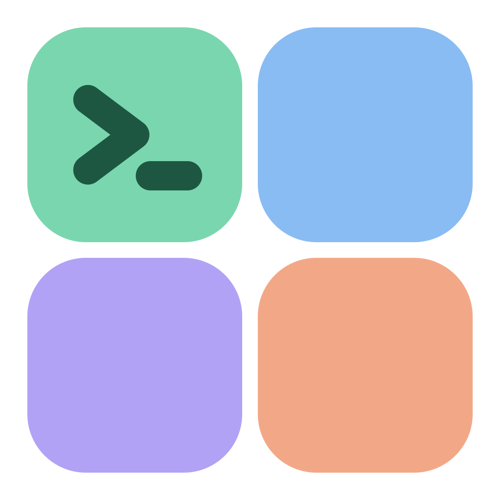
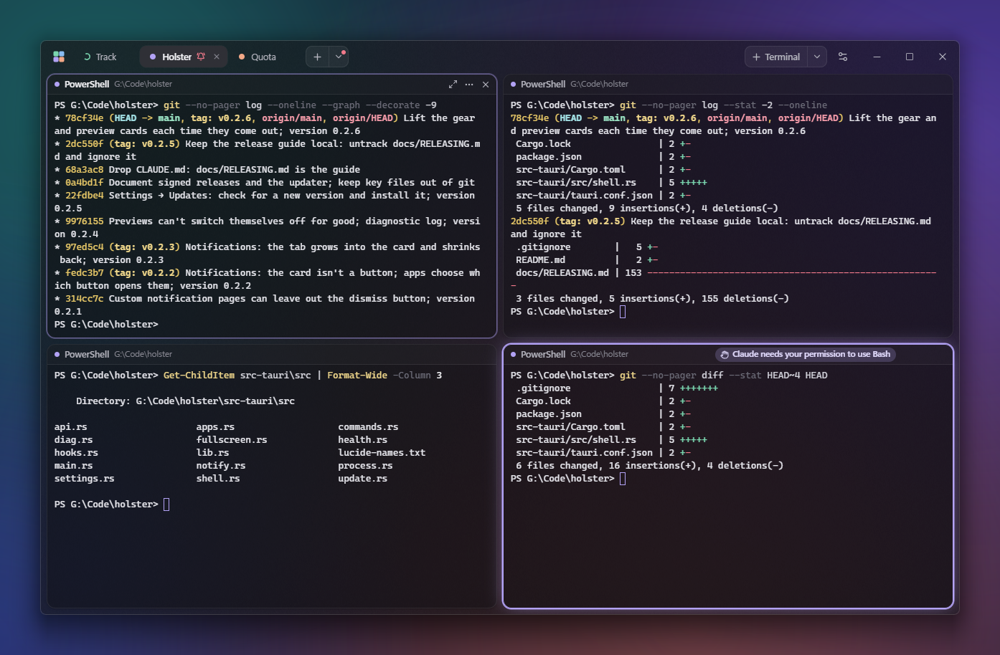
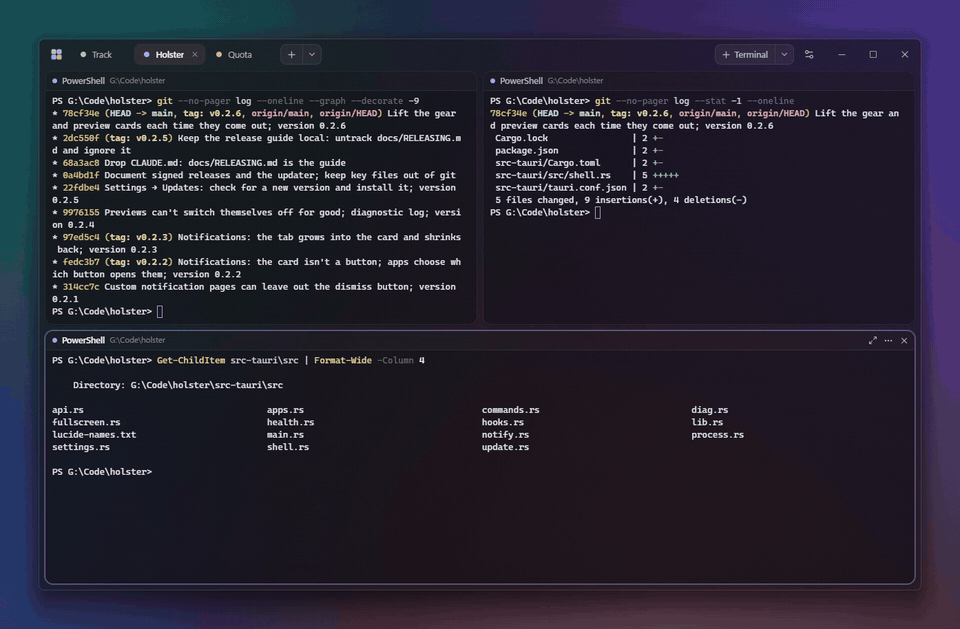

<p align="center">
  
</p>

<h1 align="center">Track</h1>

<p align="center">
  <b>Every terminal you run, in one calm window.</b><br>
  Up to sixteen real shells per screen, as many screens as you like, and a quiet tap on the shoulder when one of them needs you.
</p>

<p align="center">
  
  
  
  <a href="LICENSE"></a>
</p>

<p align="center">
  <picture>
    <source media="(prefers-color-scheme: dark)" srcset="docs/images/hero-dark.png">
    <source media="(prefers-color-scheme: light)" srcset="docs/images/hero-light.png">
    
  </picture>
</p>

---

Track is for the days when you have a dev server, a build, a couple of AI agents and a few shells open at once. Instead of a pile of windows or a row of anonymous tabs, terminals live on **screens**: each screen is a project with its own name, color, folder and sound, and holds a grid of terminals you can see all at once. When an agent asks for permission or a build rings the bell, the terminal lights up, its screen's tab shows a bell, and you hear that screen's sound.

> [!NOTE]
> Track is made for **Windows 11**. It draws with native Windows materials (acrylic, rounded corners), runs shells through ConPTY and adds itself to the Windows 11 Explorer menu, so there is no macOS or Linux build.

## Highlights

- **Screens are tabs.** Each has a name, a pastel color, a folder its terminals start in, a notification sound and, if you want, a command every new terminal there runs first (`claude`, `npm run dev`…).
- **1 to 16 terminals per screen**, in a grid that always fits: no holes, no overlapping, and a spring when terminals come and go.
- **Real shells.** PowerShell 7, Windows PowerShell, cmd, Git Bash and WSL, detected at start. Right-click a shell in the **+ Terminal** menu to run it as administrator.
- **Knows when you're needed.** Bells, OSC 9 / 777 notifications and the Claude Code hook ring the terminal, put a bell on its tab and play the screen's sound. A spinner on the tab shows an agent at work.
- **Shells outlive the window.** Closing Track hides it to the tray; only Quit ends the shells. After a restart, screens and terminals come back in their folders, and Claude Code or Codex chats pick up where they were.
- **Carry terminals around.** Drag a terminal by its header to reorder the grid, or drop it on another screen's tab to move it there.
- **"Open in Track" in Explorer**, at the top of the Windows 11 right-click menu for folders.
- **Updates itself** from GitHub releases, signed, when you press Update in Settings.

<p align="center">
  
</p>

## Install

### Download

Get the installer (`Track_<version>_x64-setup.exe`) from the **[latest release](https://github.com/ManyGlue0/Track/releases/latest)** and run it. It installs for the current user, so it needs no admin rights.

The installer isn't code-signed, so Windows SmartScreen may warn you the first time: click **More info**, then **Run anyway**.

To update, open **Settings → Updates** and press **Check**. Track downloads the new version, verifies its signature and restarts. Updating ends the shells that are running (like quitting does) and reopens your screens and terminals in their folders. Your settings and screens, in `%APPDATA%\app.track.desktop`, are kept. Running a newer installer over the old one works too.

### Build it yourself

1. Install the tools once:
   - [Visual Studio Build Tools](https://visualstudio.microsoft.com/visual-cpp-build-tools/) with the **Desktop development with C++** workload.
   - [Rust](https://rustup.rs) with the default options (stable, MSVC).
   - [Node.js](https://nodejs.org) 20 or newer, then [pnpm](https://pnpm.io/installation) (`npm install -g pnpm`).
   - WebView2 is already part of Windows 11.
2. Get the code and build the installer:

   ```sh
   git clone https://github.com/ManyGlue0/Track.git
   cd Track
   pnpm install
   pnpm release:unsigned
   ```

3. The installer is in `target\release\bundle\nsis\`. Run it like the downloaded one.

## Using it

### Screens

The **+** after the tabs opens the new-screen sheet: name, color, the folder its terminals start in (Track's own folder picker, with your recent folders, git projects next to them, places and drives), an optional command each new terminal runs, and a sound. `Ctrl+Shift+T` makes a quick one. The **⌄** next to it lists every screen, which helps once there are more tabs than fit. When they don't fit, the tab bar scrolls (the ‹ › arrows or the mouse wheel); tabs never squeeze their names.

Drag tabs to reorder them, double-click one to rename it, middle-click to close it. `Ctrl+Shift+E` edits the current screen.

### Terminals

**+ Terminal** opens the default shell in the screen's folder; its **⌄** lists every shell and recent folders. Each terminal's header shows its shell and folder (pwsh, cmd and Git Bash report where they are as you `cd`), and its **⋯** menu has copy and paste, find, clear, **Open in File Explorer**, duplicate, rename, pop out, a color, and **Move to** another screen.

- **Focus**: click a terminal to type in it, or switch Settings to *Pop out*, where the focused terminal springs into a large card over the others.
- **Drag** a terminal by its header to a new spot; the others make room. Drop it on a tab to move it to that screen. `Esc` puts it back.
- **Drop files** from Explorer onto a terminal to paste their paths.
- **Text size**: `Ctrl+=` / `Ctrl+-` for all terminals, `Ctrl+scroll` over one terminal for that one alone. Any installed font works (Settings → Look).
- **Right-click** opens the terminal's menu, or pastes (Settings). Programs that use the mouse, like Claude Code's fullscreen mode, get the right-click themselves; `Shift+right-click` is always Track's.

### Administrator terminals

Right-click a shell in the **+ Terminal ⌄** menu and choose **Run as administrator**. It opens in a normal cell marked with an amber shield. Windows doesn't let a normal app host an elevated shell, so Track starts a helper copy of itself with administrator rights (one UAC prompt) that runs the admin shells and streams them back over a private named pipe. The helper ends with Track, or a minute after its last admin shell. When Track restarts, admin terminals wait for you to press **Start as administrator** instead of prompting at sign-in.

### Shortcuts

| | |
|---|---|
| New terminal | `Ctrl+Shift+N` |
| Duplicate terminal | `Ctrl+Shift+D` |
| Close terminal | `Ctrl+Shift+W` |
| New screen | `Ctrl+Shift+T` |
| Edit screen | `Ctrl+Shift+E` |
| Next / previous screen | `Ctrl+Tab` / `Ctrl+Shift+Tab` |
| Go to screen 1–9 | `Ctrl+Alt+1…9` |
| Move focus | `Alt+Arrows` |
| Pop out | `Ctrl+Shift+Enter` |
| Find | `Ctrl+Shift+F` |
| Rename terminal | `F2` |
| Copy / paste | `Ctrl+Shift+C` / `Ctrl+Shift+V` (`Ctrl+C` copies when text is selected; `Ctrl+V` pastes) |
| Text size | `Ctrl+=` / `Ctrl+-` / `Ctrl+0` |
| Settings | `Ctrl+,` |

Every shortcut except the screen numbers can be changed in Settings.

## AI agents


**Claude Code.** Settings → AI agents → Claude Code → **Install hook** adds hooks to `~/.claude/settings.json` that run `track.exe --hook <event>`. Inside a Track terminal they tell Track when Claude is working, when it's waiting for you and which chat is open; anywhere else they exit silently. Only notifications that block on you (a permission prompt, a question) ring the terminal; Claude's idle reminders don't. Your other hooks are left alone, and **Remove** takes out only Track's.

**Codex.** Settings → AI agents → Codex → **Connect** adds Track to Codex's `notify` setting in `~/.codex/config.toml`, keeping any notify program you already had (Track calls it after itself).

**Reopen chats.** When Track restarts, a terminal that was in a Claude Code or Codex chat types `claude --resume <id>` or `codex resume <id>` at its first prompt. Both commands can be changed in Settings. A chat you end yourself is forgotten.

<br clear="right">

## Explorer menu

Settings → General → **Open in Track, in Explorer** adds **Open in Track** to the top of the Windows 11 right-click menu for folders and folder backgrounds. It opens a terminal in the screen whose folder holds that one, else in the current screen. `track <folder>` from a shell does the same.

Windows 11 only shows packaged commands at the top of that menu, so Track ships a small Explorer command (`track_shell.dll`, the `shell-ext` crate) and registers it with a sparse package whose files are Track's own folder. Registering an unsigned package from loose files needs **Developer Mode** (Settings → System → For developers); without it the row in Settings tells you so.

## Holster

Track is also a [Holster](https://github.com/ManyGlue0/Holster) app. With Holster running, Track gets a tile in the dock with a live preview of what each screen is doing, Holster's tab glows when a terminal needs you, and, while Track is in the background, Holster shows a notification ("Claude needs your permission to use Bash") with a button that opens that terminal. All of this is optional: without Holster, Track works the same.

## Your data

Everything lives in `%APPDATA%\app.track.desktop\`: `settings.json` (look, shells, shortcuts, recent and pinned folders, window placement), `workspace.json` (screens and terminals: names, colors, folders, open chats) and `sounds\` (sounds you imported). Track talks to nothing on the network except GitHub, and only when you press **Check** for updates. Its hook listener answers on loopback only.

## How it's built

Tauri 2 (Rust) with React, TypeScript and Vite; [xterm.js](https://xtermjs.org) draws the terminals, [portable-pty](https://crates.io/crates/portable-pty) runs them on ConPTY, Framer Motion animates everything.

```
src-tauri/src/
  lib.rs        app setup: window, tray, plugins, commands
  pty.rs        one ConPTY per terminal, owned by the backend so shells outlive the window;
                output streams to the UI and is kept (512 KB) for replay after a reload
  elevated.rs   administrator terminals: the elevated helper and its named-pipe protocol
  scan.rs       a small VT scanner for bells, notifications, titles, folders and progress
  shells.rs     shell detection, a fresh environment per terminal, folder reporting
  hook.rs       the --hook client and the Claude Code / Codex setup
  holster.rs    Holster manifest, preview, signals and notifications
  explorer.rs   the Explorer menu's sparse package and `track <folder>`
  update.rs     checking for and installing updates from GitHub Releases
  window.rs     the frameless acrylic window, focus and placement
src/lib/terms.ts    the xterm registry: terminals live outside React, so switching
                    screens or moving one never redraws from scratch
src/lib/layout.ts   the grid       src/lib/drag.ts   carrying terminals
shell-ext/          the Explorer command DLL
```

## Development

```sh
pnpm install
pnpm dev:app            # "Track Dev": its own data and window, beside an installed Track
pnpm release:unsigned   # the installer, with track_shell.dll, at target/release/bundle/nsis/
pnpm release            # the same, signed for the updater, plus latest.json
cargo test --manifest-path src-tauri/Cargo.toml
pnpm app-icon           # every icon size from src-tauri/icons/track-icon.svg
```

`pnpm dev:app` runs under its own identity (`app.track.dev`), so it never takes over the installed Track's Holster tile, hooks or Explorer menu. `scripts/harness/` has the small PowerShell scripts used to drive and screenshot it.

Releases are signed for the in-app updater. `pnpm release` needs Track's private key from `pnpm tauri signer generate` (`TRACK_SIGNING_KEY`, by default `%USERPROFILE%\.tauri\track.key`) and its password (`TRACK_SIGNING_KEY_PASSWORD`), in the shell or as Windows user variables. Attach the installer and `latest.json` to the GitHub release; the updater reads `releases/latest/download/latest.json`.

## License

[MIT](LICENSE)
